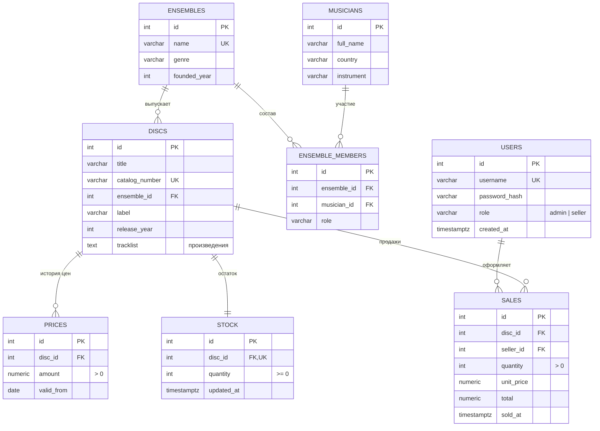

# Схема данных

СУБД — PostgreSQL 17. Схема создаётся миграциями Alembic (`alembic/versions`), команда `make migrate`.

## Таблицы и ограничения

| Таблица | Назначение | Ключевые ограничения |
|---|---|---|
| `users` | Пользователи системы | `username` уникален; `role IN ('admin','seller')` |
| `musicians` | Музыканты | — |
| `ensembles` | Ансамбли (исполнители) | `name` уникально |
| `ensemble_members` | Состав ансамблей (многие-ко-многим) | пара `(ensemble_id, musician_id)` уникальна; каскадное удаление |
| `discs` | Диски каталога | `catalog_number` уникален; `release_year >= 1900`; ансамбль с дисками удалить нельзя (`RESTRICT`) |
| `prices` | История цен диска | `amount > 0`; пара `(disc_id, valid_from)` уникальна |
| `stock` | Остаток диска на складе | одна запись на диск; `quantity >= 0` |
| `sales` | Факты продаж | `quantity > 0`; диск с продажами удалить нельзя (`RESTRICT`) |

## Правила, которые обеспечивает приложение

1. **Продажа уменьшает остаток.** Продать больше, чем есть на складе, нельзя. Строка
   остатка блокируется (`SELECT ... FOR UPDATE`) на время транзакции, поэтому параллельные
   продажи не уведут остаток в минус.
2. **Цена берётся на дату продажи.** Действует запись `prices` с наибольшей
   `valid_from <= дата продажи`. Цена и сумма записываются в `sales`, поэтому история
   продаж не меняется, когда меняется цена. Без действующей цены продажа запрещена.
3. **Целостность каталога.** Нельзя удалить ансамбль, у которого есть диски, и диск, по
   которому были продажи.
